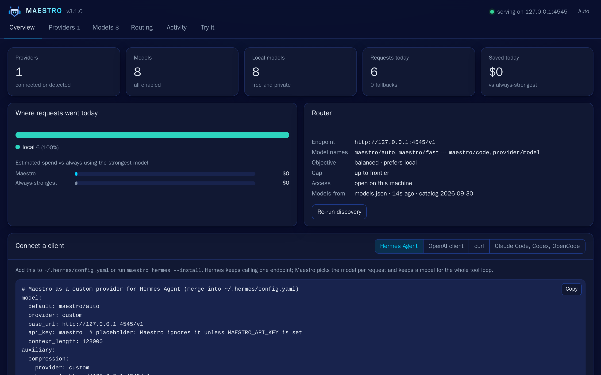

# Maestro

**Maestro sends each task to the right model you already have, local or cloud.**

[](https://github.com/this-live/maestro-router/actions/workflows/ci.yml) Apache-2.0 licensed · Python 3.9+ · no dependencies

Maestro finds the models you can use: API keys for any provider in [models.dev](https://models.dev), your Claude Code, Codex or Gemini CLI login, and models already served by Ollama, vLLM, SGLang, llama.cpp or LM Studio on your machine or network. It scores each one against public benchmarks for eleven kinds of work and picks one per task. It runs on your machine, uses only the Python standard library, and has no account and no telemetry.

**Website:** https://maestro.this.live · made by [this.live](https://this.live/)

Two ways to use it:

- **As a skill** in Claude Code, Codex, OpenCode, Gemini CLI or another agent that supports Agent Skills. The agent asks Maestro which model should take each subtask, then delegates to a subagent, another CLI or a local model. No daemon and no network on the routing path.
- **As a model provider** (`maestro-router serve`): a local OpenAI-compatible endpoint with a web dashboard. Any OpenAI client, or Hermes Agent, sends everything to `maestro/auto`; Maestro picks the model per request, falls back when a provider is rate-limited, and keeps agent loops on one model.

## Install

```bash
pip install https://github.com/this-live/maestro-router/releases/download/v3.1.1/maestro_router-3.1.1-py3-none-any.whl
# or from source:
pip install git+https://github.com/this-live/maestro-router@v3.1.1
# or run it without installing:
uvx --from git+https://github.com/this-live/maestro-router@v3.1.1 maestro-router route "fix the failing test"
```

Not on PyPI yet. The command is `maestro-router` because mobile.dev's Maestro (a mobile UI testing tool) already uses `maestro`; add `alias maestro=maestro-router` to your shell profile if you want the short name.

**As a skill** for any agent that supports Agent Skills:

```bash
npx skills add this-live/maestro-router
```

or through the Claude Code plugin marketplace:

```bash
claude plugin marketplace add this-live/maestro-router
claude plugin install maestro@maestro
```

The skills installer and the plugin marketplace track the repository's default branch (the skills installer has no option to pin a release).

Then tell your agent "use maestro", "route this" or "use the right model". OpenCode and Gemini CLI delegate by category: run `maestro-router install` once to create their `maestro-<category>` subagents.

## Quick start

**1. Ask for a decision.** This works before any setup. With nothing configured, Maestro can only tell you what the task needs:

```console
$ maestro-router route "fix the failing test"
{"job": "debug", "difficulty": 1, "confidence": 0.95, "needs": ["tools"], "classifier": "rules", "category": "standard",
 "seat": "inline", "model": null, "delegate": {"kind": "inline"}, "reason": "debug/d1 → standard; no seat available at any tier", ...}
```

**2. Add your models.** Any of these:

- an API key in your environment (`OPENAI_API_KEY`, `ANTHROPIC_API_KEY`, `OPENROUTER_API_KEY`, ...), or stored with `maestro-router keys set openai` (hidden input; saved to `~/.maestro/keys.env`, mode 600);
- a model server you already run: Ollama, LM Studio, vLLM, SGLang and llama.cpp on their default localhost ports are found on their own, and a box on your network is added with `maestro-router setup --endpoint http://<host>:<port>`;
- a Claude Code, Codex or Gemini CLI login, which is detected on its own.

Then run setup, which detects everything, scores every model and writes your model map:

```bash
maestro-router setup
```

**3. Serve.** Start the endpoint and the dashboard, and send a request:

```bash
maestro-router serve --open
```

```console
$ curl -si http://127.0.0.1:4545/v1/chat/completions -H 'Content-Type: application/json' \
    -d '{"model": "maestro/auto", "messages": [{"role": "user", "content": "What is a mutex? Answer in one sentence."}]}'
x-maestro-decision: {"job": "ask", "difficulty": 0, "category": "local", "model": "local:host/qwen2.5:7b-instruct",
                     "reason": "ask/d0 -> local; local:host/qwen2.5:7b-instruct (ask 0.30, free)", ...}
{"model": "local:host/qwen2.5:7b-instruct", "choices": [{"message": {"role": "assistant",
 "content": "A mutex (mutual exclusion) is a synchronization mechanism used in programming to prevent multiple threads ..."}}], ...}
```

That output is from a fresh install on a clean machine with one Ollama server (named `host`) and no API keys. `maestro-router serve --open` also opens the dashboard, shown here after six requests on that machine:



The response's `model` is the model Maestro chose, and the `x-maestro-decision` header says why. Any OpenAI client works the same way:

```python
from openai import OpenAI
client = OpenAI(base_url="http://127.0.0.1:4545/v1", api_key="anything")
r = client.chat.completions.create(model="maestro/auto", messages=[{"role": "user", "content": "why is my test flaky?"}])
print(r.model)   # the model Maestro chose
```

For Hermes Agent, `maestro-router hermes --install` adds Maestro to `~/.hermes/config.yaml` after making a backup, and `maestro-router hermes --print` prints the block instead.

## How it works

```
task text ──► classify ──► (job, difficulty 0-3, confidence, needs)
                 ▼
            policy ladder  ──► local | fast | standard | strong | frontier
                 ▼
     your model map (cached) ──► a model you have that is good enough for the job ──► decision, with fallbacks
```

- **Eleven jobs:** plan, code, debug, review, ops, research, data, write, edit, summarize and ask. The offline classifier sorts each task into one, with a difficulty from 0 (easy) to 3 (very hard).
- **Six categories:** `local` (models you run yourself), `fast`, `standard`, `strong`, `frontier`, and `specialist` (models tuned for a job, such as a coder model). The ladder maps a job and a difficulty to a category:

| job | d0 | d1 | d2 | d3 |
|---|---|---|---|---|
| ask, summarize, edit | local | fast | standard | standard |
| write, data, research, code, ops | fast | standard | standard | strong |
| review, debug | standard | standard | standard | strong |
| plan | standard | standard | strong | frontier |

- **Your model map.** `maestro-router discover` (run by `setup`) joins every model you can call to a bundled models.dev snapshot, turns benchmarks, size, price and age into a strength for each job and a category, and caches it in `~/.maestro/`. Each decision then picks a model you have that is good enough for that job, cheapest first by default, and says why.
- **Local models.** Maestro never downloads, loads or starts a model. It routes only to what a server has already loaded; installed-but-not-loaded models are listed and skipped.

Two diagrams in [docs/architecture](docs/architecture/README.md) show how a task becomes a model choice. Every command, config key and option is in the [reference](docs/REFERENCE.md).

## Router accuracy

The offline rules classifier on the 237 held-out prompts it was not tuned on (the odd lines of `evals/prompts.jsonl`):

| metric | result |
|---|---|
| job accuracy (11 jobs) | 80.2% |
| category accuracy | 65.0% |
| category within one step | 99.6% |
| under-routed (category too weak) | 8.0% |
| severely under-routed (two or more steps) | 0.0% |

Reproduce it with `python evals/run.py --classifier rules --split test`; CI fails if these drop. The prompts and labels were written by an LLM and only partly checked by hand, and about 15% could fairly belong to two jobs. These numbers measure the routing choice, not the quality of the answers. Details are in the [reference](docs/REFERENCE.md#benchmarks).

## Privacy and security

- Keys you add live in `~/.maestro/keys.env` (mode 600). A key is sent only to its own provider and is never printed, logged or returned by any endpoint.
- Detection checks that keys and logins exist; it never reads key values or login tokens. Subscription logins are used only through their own CLIs.
- The request log keeps the model, job, category, latency and tokens. Prompt text is stored (first 120 characters) only if you set `log_prompts: true`.
- No telemetry. A request goes only to the provider you route it to. The optional Jev classifier sends task text to TypeSafe only if you set `TYPESAFE_API_KEY` (see the [reference](docs/REFERENCE.md#classifiers)).
- `maestro-router serve` binds to 127.0.0.1. Serving beyond loopback requires `MAESTRO_API_KEY`, and the dashboard needs an admin token and same-origin requests.
- `MAESTRO_HOME` moves everything out of `~/.maestro`.

Found a security problem? See [SECURITY.md](SECURITY.md).

## What it does not do

- It is not a hosted service. There is no cloud version, account or paid plan.
- It does not give you models. It routes to the keys, logins and model servers you already have.
- It never downloads, loads or starts a model.
- It does not judge the answers. It picks a model before the request is sent.
- The decision model (S1) and expected-utility routing are in shadow mode and off by default; the ladder decides. See [Maestro S1](docs/REFERENCE.md#maestro-s1-the-decision-model).
- In provider mode, subscription seats (Claude Code, Codex, Gemini CLI) serve chat only, never tool calls or images.

## Development

```bash
python -m unittest discover -s tests -v              # stdlib unittest only
python evals/run.py --classifier rules --split test  # the router eval that CI gates
python3 site/serve.py                                # the website on http://127.0.0.1:8080
```

[CLAUDE.md](CLAUDE.md) has the contributor rules, [docs/DESIGN.md](docs/DESIGN.md) is the spec, and [CHANGELOG.md](CHANGELOG.md) lists what changed.

## License

Apache License 2.0. See [LICENSE](LICENSE); bundled data is listed in [NOTICE.md](NOTICE.md). Maestro is made by [this.live](https://this.live/).
